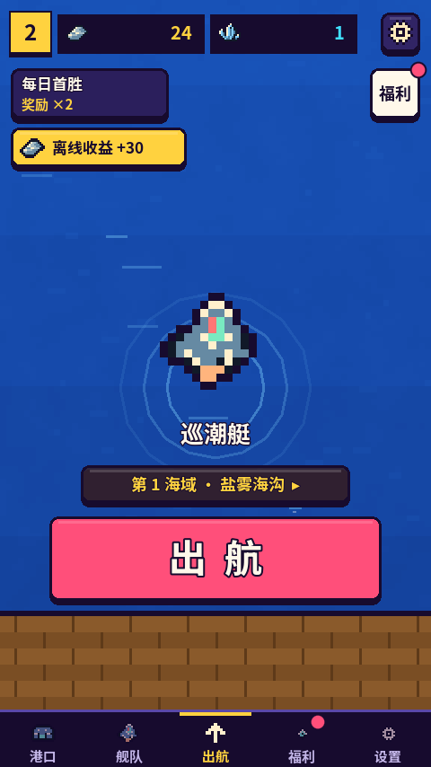
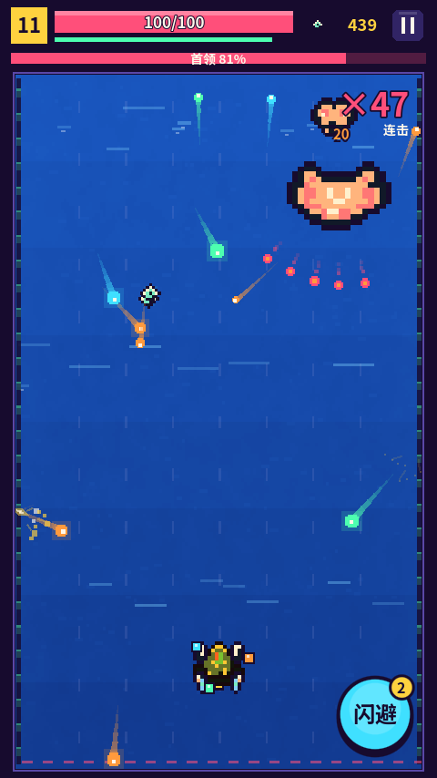
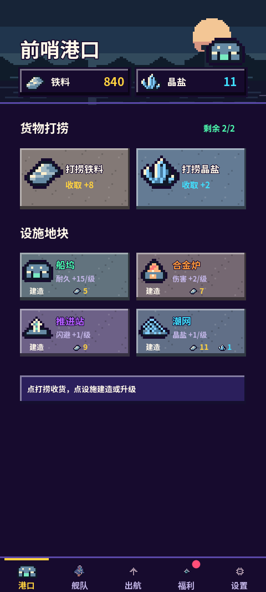

# 潮汐前哨 · Tide Outpost

一款竖屏像素航海动作游戏。拖动舰艇躲避敌人，利用反弹弹球迎击敌潮，在港口收集资源并升级装备。

## 运行游戏

用 Godot 4.7.2 导入根目录的 `project.godot`，按 `F5` 启动。在战斗区任意位置按住拖动即可操控舰艇（相对拖动，手指不会挡住舰艇），桌面端可用鼠标或 WASD。瞄准和弹球回收自动进行。单局升到 3 级解锁闪避，之后双击屏幕冲刺（桌面端空格）。中后期部分敌人会回血（绿十字）或闪避弹球（蓝箭头）。升级时战斗放慢，点一张卡立即生效（桌面端 1/2/3）。

Android 安装包和 Windows x86-64 版在 [GitHub Releases](https://github.com/GCUSMS-AI-ProJect/goto_game_pixel/releases) 下载。最新的 Android 测试包也可以用手机浏览器打开 <https://create.workstudioai.top/> 直接安装。

## 工程目录

| 路径 | 内容 |
| --- | --- |
| `scenes/` | 游戏入口场景 |
| `scripts/game/` | 航行、战斗、强化和港口逻辑 |
| `scripts/ui/`、`scripts/visuals/` | 战斗布局、像素绘制与特效 |
| `scripts/audio/` | 音乐切换与音效管理 |
| `assets/backgrounds/` | 航海图、港口与战斗海域背景 |
| `assets/sprites/` | 舰艇、敌人、资源、港口设施、装备和界面图标 |
| `assets/audio/music/`、`assets/audio/sfx/` | 背景音乐和音效 |
| `assets/branding/`、`assets/fonts/` | 应用图标、字体及字体授权 |
| `docs/screenshots/` | 游戏界面截图 |
| `tools/` | 原声音乐与音效生成脚本 |

像素图使用原始分辨率的 PNG，文件名采用小写英文和下划线。字体采用 [SIL Open Font License 1.1](assets/fonts/OFL.txt)。

## 导出

安装与编辑器版本一致的 Godot 导出模板。Android 导出还需要 JDK 17 或更高版本，并在 Godot 编辑器设置里填写 Android SDK 和 JDK 的路径。创建 `dist/` 目录，然后在项目目录运行对应命令。

```text
godot --headless --path . --export-release Windows dist/tide-outpost-windows-x86_64.exe
godot --headless --path . --export-release Android dist/tide-outpost-android.apk
```

Android 正式包用发布证书签名，证书不放进仓库。导出前用环境变量告诉 Godot 证书位置：

```text
GODOT_ANDROID_KEYSTORE_RELEASE_PATH=<release.keystore 的路径>
GODOT_ANDROID_KEYSTORE_RELEASE_USER=<证书别名>
GODOT_ANDROID_KEYSTORE_RELEASE_PASSWORD=<证书密码>
```

之后的每个版本都必须用同一个证书签名，否则手机上无法覆盖安装，商店也不接受更新，所以证书要妥善备份。每次发布前在 `export_presets.cfg` 里调高 `version/code` 和 `version/name`。上架时按目标商店选择 APK 或 AAB。

音乐和音效由 `tools/` 里的脚本生成，前两个需要 `numpy` 和 `scipy`。

1. `python tools/compose_tide.py`：生成港口和搜索音乐，以及其余音效。它需要 `imageio-ffmpeg`。
2. `python3 tools/compose_battle.py`：生成战斗音乐、首领叠加层和击打音效。它需要 `PATH` 里有带 libvorbis 的 `ffmpeg`。
3. `python tools/make_impact_sfx.py`：生成金币音效 `coin.wav`，只用标准库。

`compose_tide.py` 也会写入 `voyage.ogg`、`boss.ogg`、`hit.wav` 和 `blast.wav`，`make_impact_sfx.py` 也会写入 `thump.wav`。所以 `compose_battle.py` 必须最后运行，否则战斗音乐和击打音效会退回旧版本。

## 界面预览

截图为 20:9 手机屏幕。

  
